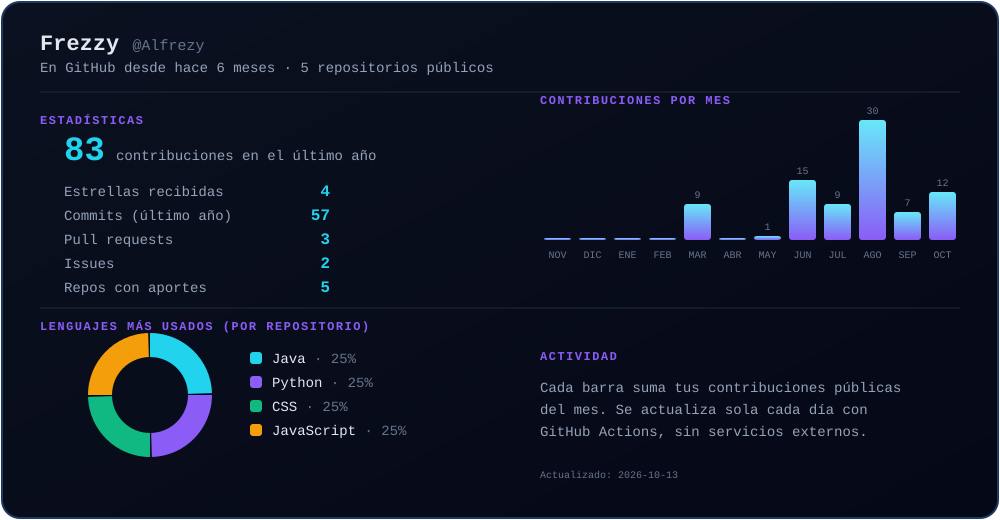

  

  <h1>Frezzy</h1>
  

    <strong>Estudiante de programación</strong> · Java · C · Python · IoT con ESP32
  

  
  

 

## Sobre mí

<table>
  <tr>
    <td width="50%" valign="top">
      <h3>⚙️ Lo que construyo</h3>
      

        Proyectos de programación, electrónica e IoT: desde aplicaciones en
        Java hasta una cámara ESP32 que alimenta redes neuronales (Mini Wall-E).
      

    </td>
    <td width="50%" valign="top">
      <h3>📚 Siempre aprendiendo</h3>
      

        Estudio programación, sistemas operativos libres y electrónica,
        y subo mis prácticas para seguir mejorando.
      

    </td>
  </tr>
</table>

## Tecnologías

  
  
  
  
  
  
  
  
  

## 📊 Estadísticas de GitHub

  

## 🐍 Contribuciones en serpiente

  <picture>
    <source media="(prefers-color-scheme: dark)" srcset="https://raw.githubusercontent.com/Alfrezy/Alfrezy/output/github-snake-dark.svg">
    <source media="(prefers-color-scheme: light)" srcset="https://raw.githubusercontent.com/Alfrezy/Alfrezy/output/github-snake.svg">
    
  </picture>

 

  ⭐ Si algún proyecto te sirvió, deja una estrella. ¡Gracias por pasar!

